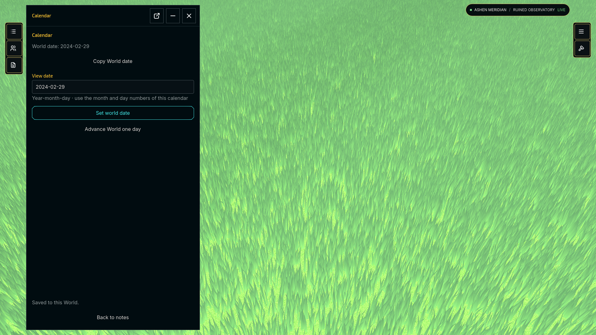
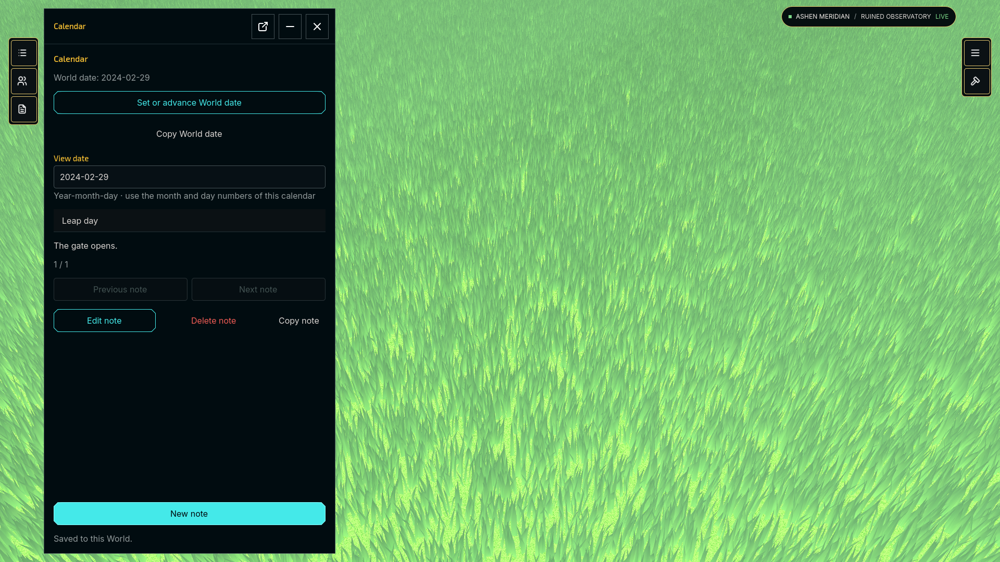

# Calendar

An ordinary optional Rookframe Package, developed throughout Project 02. It
opens an authored date view and dated-note editor from the left Rail.
The GM sets or advances the saved World date and maintains dated notes. The example uses
classic Gregorian or custom calendar rules; it requires no remote account.

Package ID: `aae579da-5392-4507-8eaa-0d918af58076`.
Package version: `0.9.3`. SDK Edition: `2029`, minimum revision `34`.





These are native Rookframe desktop captures of Calendar 0.9.0, using the
controlled System Extension for the tabletop. Calendar owns the date-and-notes
window; the host owns the surrounding workspace and durable World save. The
captures are reused from RFG-231; Calendar 0.9.1 preserves this authored UI.

## Clean clone

Use stock Godot **4.7.2 .NET**, matching export templates, Git, Python **3.10+**
and an installed Rookframe application. The gd-plug bootstrap and license are included.

```sh
git clone https://github.com/rookframe/rookframe-calendar.git
cd rookframe-calendar
/path/to/godot --headless --path . --script plug.gd install
python3 addons/rookframe_sdk/rookframe_authoring.py check --project . --godot /path/to/godot --rookframe /path/to/Rookframe
python3 addons/rookframe_sdk/rookframe_authoring.py build --project . --godot /path/to/godot --rookframe /path/to/Rookframe --output build/calendar.rookpackage
```

The exact SDK, Development Plugin and UI Kit dependencies are recorded in
`plug.gd` and `.rookframe/authoring.lock.json`. Downloaded SDK scripts live at
`rookframe/sdk/`; no generation or C# build is needed. The installed application
checks source and exported archives. Use a fresh output filename for every build.

Open `project.godot` and enable **Rookframe Development**. Use its Package Check
and Build commands, or select the installed Rookframe application and a saved
Development World in the dock. An editable Calendar needs a published System
Manifest URL. Reuse that World while saving scripts and scenes.

Calendar's archive contains its own source and assets. Rookframe supplies the SDK
and UI Kit. Commit authored files and exact dependency pins; ignore downloaded
dependencies, caches, local World configuration and build output.

For ordinary application checks, publish the reviewed Package, install it using
its public HTTPS Manifest URL, and enable Calendar in the World. Participants
joining the World acquire the same release automatically. Local archive imports
are not part of this workflow.

## How the integration is authored

`ui/desktop.gd`, `ui/tablet.gd` and `ui/phone.gd` extend the SDK Presentation base. Rookframe binds
its typed `sdk` automatically before `compose()`:

```gdscript
const CALENDAR_WINDOW_BUTTON: SDK.WindowButton = preload("res://rookframe/packages/aae579da-5392-4507-8eaa-0d918af58076/ui/window_button.tres")

func compose() -> void:
    var rail: SDK.Rail = sdk.rails.left
    rail.push(CALENDAR_WINDOW_BUTTON)
```

Open `ui/window_button.tres` in Godot's Inspector. Its `button_scene` points to
`ui/calendar_button.tscn`; its typed `window` target points to `ui/window.tscn`.
Edit the button's appearance in its scene and the Calendar content in the window
scene. The SDK owns the standard opening action, native instantiation, mounting,
reopening and cleanup. There is no Package-written signal connection, host
adapter, string-based mount call or rejected-control disposal.

Paths in this section are beneath `rookframe/packages/aae579da-5392-4507-8eaa-0d918af58076/`.

## Date and note workflow

Choose **Set or advance World date** to change the World date, then **Back to notes** to browse the selected date. **New note** and **Edit note** open the compact editor; **Save note** returns to the saved list.

The supported range is **0001-01-01 through 9999-12-31**, using the proleptic
Gregorian calendar and canonical `YYYY-MM-DD` spelling. A leap year is divisible
by 4, except century years must also be divisible by 400. There are no time zones,
real-world scheduling rules, recurrence, reminders or external accounts.

A new World has no Calendar data until its GM enters a valid date and explicitly
presses **Set world date**. **Advance one day** changes the saved World date,
including month/year/leap-day boundaries. The maximum date cannot advance.
Changing **View date** only browses notes and changes the date for a new draft.
Invalid input leaves the committed state unchanged.

Enter a title and body and press **Save note** to create a dated note. Browse the
selected date with **Previous note** / **Next note**, choose **Edit note** to load
that note into the draft, save the edit, or choose **Delete note**. **New note**
explicitly starts a new draft. Accepted changes refresh from the public SDK and
survive leave/reopen and host-owned Copy/export/recovery. Failed saves never show
success; a durable failure ends the World so reopening restores its prior save.

The canonical value belongs to Rookframe's automatically scoped Package World
Data Handle. Calendar stores pure values (`schema`, ISO World date, notes and next
note ID), so retaining it never requires Calendar scripts. `CalendarData`,
`CalendarNote`, and `GregorianDate` are temporary typed helpers, acquired afresh for
each operation; only UI selection and an unfinished draft stay in the window.
No copied Actor/Rook records, calendar database, host calendar schema, synchronized
Node tree or additional replication system exists. A release that cannot interpret
retained values reports that state without rewriting them. GM access comes from
the host context, never an identity or flag supplied by Calendar. Date/note data
is currently accessible only on World Authority. A joining Player runs the same
Implementation and may use local Settings, but date/note queries and writes
report unavailable there. No automatic Package World Data replica or private
Calendar transport is supplied. A headless Authority runs the Implementation
and registers Settings without constructing a Calendar Presentation.

Run the focused domain checks (they are excluded from Package exports):

```sh
python3 tests/run_domain_tests.py --godot /path/to/godot
```

They cover Gregorian boundaries, explicit initialization, invalid/range input,
note creation/edit/deletion, dated browsing and interpreting a newly supplied copy
of the saved pure value. The host's focused SDK/store tests cover authorization,
real codec round-trips, failed durable saves, retention and recovery.

Desktop, tablet and phone Presentations register the same authored window scene,
so an unfinished note and navigation state survive switching, closing and
reopening. The host uses its current logical canvas and owns docking, floating,
minimizing, orientation and shutdown. Drafts end when leaving the World.
The date helper is temporary typed calculation state, not authoritative data.
German translations are declared as a normal Godot Translation and accessed
through `sdk.translations`; the standalone scene keeps English source labels.

## Calendar Settings

Open **Game Menu → Package Settings → Calendar**. World Settings contains the
Calendar title and a choice between classic Gregorian rules and a custom calendar.
Custom calendars have 1–64 named months, each with 1–366 days, and 1–32 named
weekdays. Month and weekday names must be distinct within their list. Weeks run
continuously across month/year boundaries. Custom years repeat their month lengths
without leap days; classic rules retain Gregorian leap years.

My Settings chooses numeric or named date display. Presentation is a separate
section. Edits are staged until the containing scope's Save button succeeds.
Only the World Authority GM can publish calendar rules.

Changing rules relabels existing days instead of rewriting history. Day 1 of year 1
is the common origin; retained Gregorian dates remain the canonical day identity
in Package World Data, so every note stays attached to the same day. Numeric
custom input uses year-month-day numbers in the selected calendar, for example
`0001-02-03`; changing rules can change those labels and the displayed year.
The supported day range remains Gregorian 0001-01-01 through 9999-12-31.
Older Calendar releases can still read the retained dates and notes.

The public SDK uses typed `TextListSetting`, `IntegerListSetting`, `TextList`,
and `IntegerList` values; the custom view builds drafts through typed setters.
This release uses Edition 2029 revision 1 through SDK 0.9.2. Earlier releases
introduced these settings through Edition 2027 revision 7.


## Copy a date or note

**Copy date** copies the displayed World date using the active classic/custom
rules and this user's date format. **Copy note** copies the selected saved note's
title and body. Both use the public typed scoped clipboard service and report
success or the device's unavailable/denied outcome. Copying needs no network
provider, account or sign-in. Calendar remains fully useful offline.


## Manager lifecycle acceptance

[The release lifecycle guide](docs/manager-lifecycle.md) covers installation,
exact updates, disabled releases, matching repair and deliberate data removal.
Calendar 0.9.1 preserves the 0.9.0 pure date/notes representation and Edition
2029 contract. Use a Rookframe build containing the RFG-231 portability fix.


## Catalogue release 0.9.1

The public Manifest for this exact release is
[rookframe.json](https://github.com/rookframe/rookframe-calendar/releases/download/v0.9.1/rookframe.json).
The same release contains [Calendar-0.9.1.rookpackage](https://github.com/rookframe/rookframe-calendar/releases/download/v0.9.1/Calendar-0.9.1.rookpackage).
The archive and Manifest are one checked build; retries reuse them and never
replace a published version. The Package ID remains unchanged. The upgrade
retains the previous pure date/notes representation and existing calendar settings.

Install from this Manifest link in Manager. Catalogue releases appear in Browse
Catalogue after approval; choose the exact version shown before installing. Include
it in a World with exactly one System Extension, open the World, and select its
Calendar rail entry. Local archive import works independently of Catalogue.
A listing is metadata and does not certify or authenticate Package code.

Maintainers publish from a clean checkout of the exact source commit, with the
pinned dependencies installed, using the SDK's separate deliberate command:

```sh
python3 addons/rookframe_sdk/rookframe_authoring.py publish-github \
  --project . --archive build/Calendar-0.9.1.rookpackage \
  --repo rookframe/rookframe-calendar --tag v0.9.1 --commit FULL_SOURCE_COMMIT
# Review the printed exact build/destination, then repeat with --confirm.
python3 addons/rookframe_sdk/rookframe_authoring.py catalogue propose \
  --manifest https://github.com/rookframe/rookframe-calendar/releases/download/v0.9.1/rookframe.json \
  --output /private/path/calendar-proposal.json
# Review the proposal, then submit explicitly:
python3 addons/rookframe_sdk/rookframe_authoring.py catalogue submit \
  --proposal /private/path/calendar-proposal.json --confirm
```

Publisher registration, email confirmation and sign-in are documented in the
[SDK publication guide](https://github.com/rookframe/rookframe-sdk/blob/v0.36.0-rc.1/PUBLICATION.md).
They are only needed for the Catalogue record. Building, testing and direct
installation need no Publisher account. The existing custom calendar/settings
features remain part of Calendar; this release introduces no new date model.


## Automated tests

With dependencies installed, run the Calendar domain and settings checks:

```sh
python3 tests/run_domain_tests.py --godot /path/to/Godot
```

The runner requires the `CALENDAR_DOMAIN PASS` marker and fails on engine errors
or a timeout. It checks date arithmetic, persisted notes, custom calendars and
month-setting validation. Host behavior is checked in rookframe-godot.
